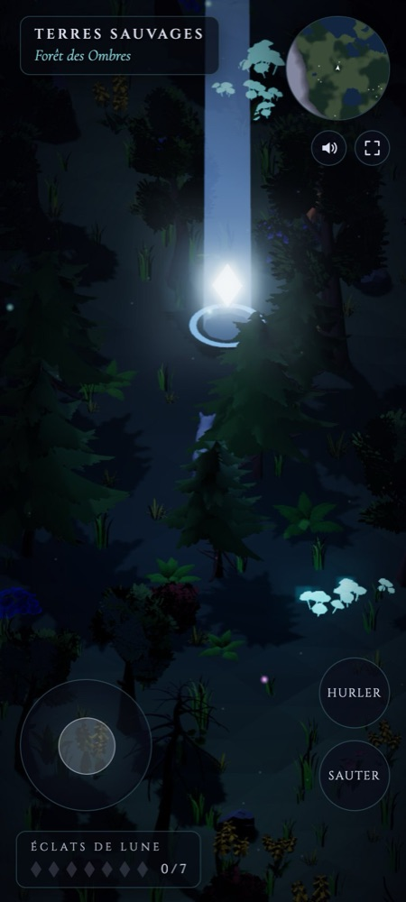
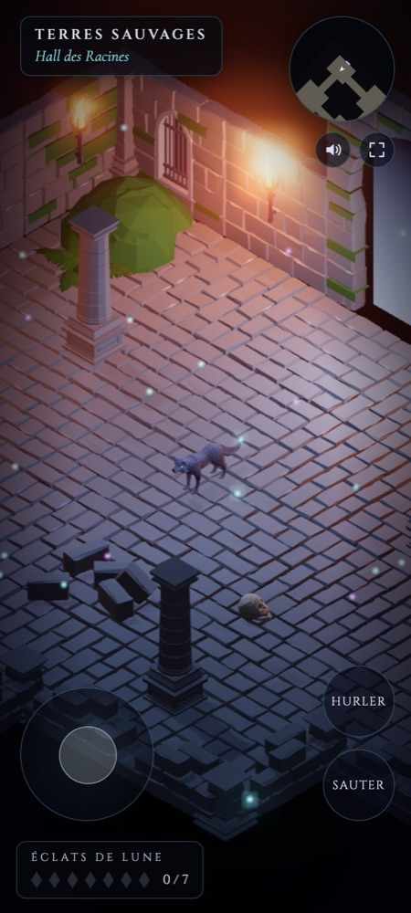
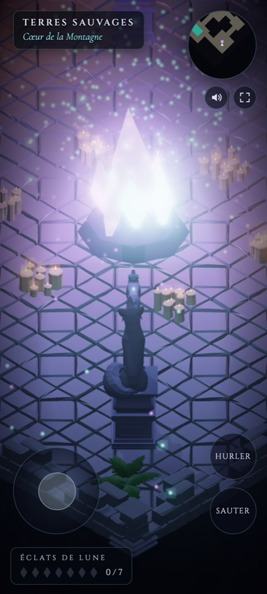
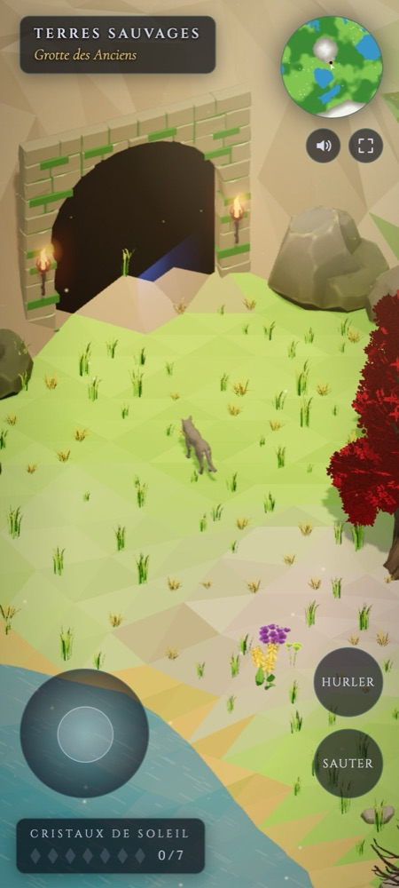

# Le Loup des Terres Sauvages

Jeu 3D isométrique dans le navigateur. Un loup explore une grande terre sauvage — clairières, forêts, six lacs et deux sommets, entourés de montagnes. La nuit, il cherche sept éclats de lune à rapporter au Cercle des Pierres Anciennes : le monde bascule alors en plein jour, couleurs éclatantes et chants d'oiseaux. Sept cristaux de soleil permettent ensuite de rappeler la nuit, et le cycle recommence avec de nouveaux cristaux. Cerfs, chevaux, renards et une soixantaine d'autres animaux y vivent et fuient quand le loup hurle.

Au flanc est du Mont des Hiboux, une arche entourée de torches mène à la **Grotte des Anciens** : un réseau de ruines souterraines (hall, salle des gardiens, bassin, crypte, réserve) qui mène au Cœur de la Montagne. Hurler près de ses cristaux fait répondre un chœur de loups. L'arche lumineuse du hall ramène dehors.

**Jouer en ligne :** https://bertrandg.github.io/game-wolf/

## Captures d'écran

Prises en format téléphone (Pixel 9a), avec les commandes tactiles.

<p align="center">
  
  
  
  
</p>

<p align="center"><sub>De gauche à droite : Un éclat de lune, la nuit · Hall des racines · Cœur de la Montagne · la grotte, en plein jour</sub></p>

## Commandes

| Touche | Action |
| --- | --- |
| ZQSD / WASD / flèches | se déplacer |
| Espace | sauter |
| Maj | courir |
| H | hurler (fait fuir les animaux proches) |
| Molette | zoom |
| M | couper / remettre le son |
| F | plein écran |

Sur mobile : joystick à gauche (poussé à fond pour courir), boutons Sauter et Hurler à droite, zoom à deux doigts. Les boutons son et plein écran sont sous la mini-carte (le plein écran n'existe pas sur iPhone, le bouton y est masqué).

## Technique

- Le jeu tient dans `index.html`, sans étape de build. Les modèles 3D sont dans `assets/`.
- [Three.js](https://threejs.org/) 0.160.0 chargé depuis jsDelivr (bloom, chargement glTF, clonage des squelettes).
- Monde généré procéduralement (bruit de Perlin, graine fixe) sur environ 720 × 720 unités.
- Sons synthétisés avec la Web Audio API, aucun fichier audio : vent et nappe grave la nuit, accord chaud, brise et oiseaux le jour.
- Bascule jour / nuit : chaque sommet du terrain porte une couleur de nuit et une de jour, mélangées dans le shader ; lumières, brouillard, eau, végétation et particules suivent le même curseur.
- Arbres, buissons, fleurs, fougères, herbe, rochers, galets et champignons : *Stylized Nature MegaKit* (version gratuite) de [Quaternius](https://quaternius.com/), licence CC0. 25 modèles regroupés dans `assets/nature.glb` (textures réduites à 512 px en WebP, cartes de relief retirées) : environ 2 Mo au lieu de 34 Mo.
- Grotte : *Ultimate Modular Ruins Pack* de [Quaternius](https://quaternius.com/), licence CC0. 39 pièces (murs, sols, colonnes, torches, statues, meubles) converties d'OBJ en un seul `assets/ruins.glb` compressé d'environ 1 Mo.
- Loup et animaux : pack *Ultimate Animated Animals* de [Quaternius](https://quaternius.com/), licence CC0. Les modèles ont été convertis en GLB compressé avec [glTF Transform](https://gltf-transform.dev/) (quantification, animations inutilisées retirées) : environ 330 Ko par animal au lieu de 3 Mo.

### Performances

- La grotte est une scène à part, dessinée à la place du monde : environ dix fois moins de triangles que l'extérieur. Ses pièces sont dessinées en instances regroupées par blocs, avec des matériaux Lambert (moins coûteux). Seules quelques lumières suivent les torches les plus proches du loup ; elles s'éteignent en douceur avant de changer de torche. La grotte est envoyée au GPU pendant l'écran d'accueil.

- Terrain découpé en 12 × 12 blocs, arbres, rochers et champignons regroupés par bloc : seuls les blocs visibles sont dessinés.
- La hauteur du sol est lue dans une grille précalculée au lieu de recalculer le bruit.
- L'herbe n'existe qu'autour du loup : un nombre fixe de touffes est replacé quand il change de case, aux mêmes endroits du monde à chaque passage. Elle ondule grâce au shader.
- Les feux follets flottent grâce à un shader : aucun calcul processeur par image.
- Les animaux loin du loup sont cachés et simulés grossièrement deux fois par seconde, sans animation.
- Anticrénelage : MSAA 4× sur les cibles de rendu (le bloom empêche l'anticrénelage natif du canvas), alpha-to-coverage pour les bords des feuilles et des fleurs, filtrage anisotrope des textures. En qualité basse, un filtre FXAA remplace le MSAA.
- Pas d'à-coups en marchant : shaders compilés et décor envoyé au GPU pendant l'écran d'accueil, herbe recalculée tous les 3 pas seulement à partir d'une grille précalculée, mini-carte redessinée 10 fois par seconde, zone d'ombre ajustée au champ visible.
- Qualité adaptative : sur mobile, résolution limitée à 1,25×, bloom en demi-résolution et ombres plus légères. Si les images ralentissent (moins de 50 par seconde), le jeu baisse d'un cran (résolution, bloom, ombres), puis remonte quand tout redevient fluide.

## Lancer en local

Les modules ES demandent un serveur HTTP :

```bash
python3 -m http.server 8765
```

Puis ouvrir http://localhost:8765.
